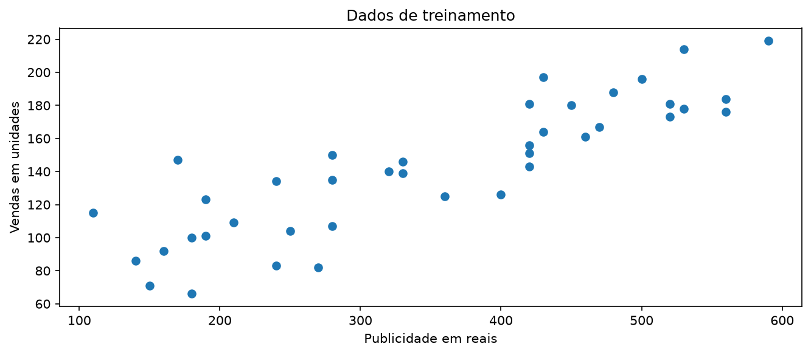
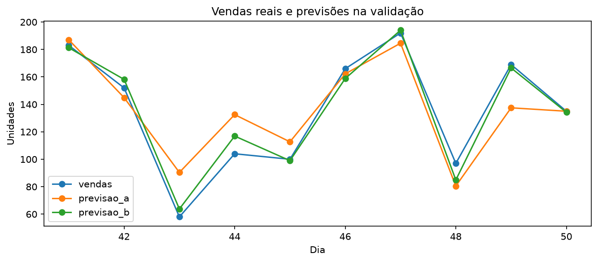

<div align="center">

# 📈 Previsão de Vendas com Regressão Linear

**Comparação de dois modelos de Machine Learning usando publicidade e desconto para estimar vendas diárias.**


</div>

## 🎯 Objetivo

Investigar se incluir o **percentual de desconto** junto com o **investimento em publicidade** melhora a previsão da quantidade de vendas de uma loja.

O estudo compara dois modelos de regressão linear usando a **mesma base simulada de 60 dias** e a **mesma divisão cronológica** de treinamento, validação e teste. A variável alvo é `vendas`.

| Modelo | Variáveis de entrada | Variável prevista |
|:--|:--|:--|
| **A** | `publicidade` (R$) | `vendas` |
| **B** | `publicidade` (R$) + `desconto` (%) | `vendas` |

## 🧪 Metodologia

| Etapa | Período | Quantidade | Finalidade |
|:--|:--|--:|:--|
| **Treinamento** | Dias 1 a 40 | 40 | Ajustar os coeficientes dos modelos com `fit()` |
| **Validação** | Dias 41 a 50 | 10 | Comparar A e B pelo MAE e escolher um modelo |
| **Teste** | Dias 51 a 60 | 10 | Avaliar somente o modelo escolhido em dados não utilizados na escolha |

> [!IMPORTANT]
> A base e a separação dos períodos foram mantidas. O conjunto de teste **não participa da escolha** do modelo.

### Visualização dos dados de treinamento



*Figura 1 — Visualização dos dados do período de treinamento.*

## 🏆 Resultados

### Comparação dos modelos na validação

| Indicador | Modelo A | Modelo B |
|:--|--:|--:|
| **MAE na validação** | **14,40** | **5,22** ✅ |
| Dias com menor erro absoluto | 2 | 8 ✅ |
| Maior erro absoluto | 32,40 (dia 43) | 12,90 (dia 44) ✅ |
| Entradas utilizadas | Publicidade | Publicidade e desconto |

O **modelo B** foi escolhido porque apresentou o **menor MAE na validação**: aproximadamente **63,7% menor** que o do modelo A. Isso indica previsões mais próximas das vendas observadas **neste conjunto de validação**.



*Figura 2 — Comparação das vendas reais com as previsões dos modelos A e B nos dias de validação.*

### Tabela detalhada da validação

Os erros são **absolutos**, isto é, `|vendas reais − previsão|`. Os números abaixo foram arredondados a duas casas decimais apenas para exibição.

| Dia | Vendas reais | Previsão A | Erro A | Previsão B | Erro B | Menor erro |
|---:|---:|---:|---:|---:|---:|:--|
| 41 | 183 | 187,04 | 4,04 | 181,24 | 1,76 | **B** |
| 42 | 152 | 144,91 | 7,09 | 158,20 | 6,20 | **B** |
| 43 | 58 | 90,40 | 32,40 | 63,76 | 5,76 | **B** |
| 44 | 104 | 132,52 | 28,52 | 116,90 | 12,90 | **B** |
| 45 | 100 | 112,70 | 12,70 | 98,98 | 1,02 | **B** |
| 46 | 166 | 162,26 | 3,74 | 158,84 | 7,16 | **A** |
| 47 | 192 | 184,56 | 7,44 | 194,05 | 2,05 | **B** |
| 48 | 97 | 80,48 | 16,52 | 84,90 | 12,10 | **B** |
| 49 | 169 | 137,48 | 31,52 | 166,53 | 2,47 | **B** |
| 50 | 135 | 135,00 | 0,00 | 134,19 | 0,81 | **A** |

**Resumo:** A teve menor erro nos dias **46 e 50**; B, nos dias **41, 42, 43, 44, 45, 47, 48 e 49**. Não houve empates. No dia 50, o erro de A é aproximadamente **0,0017**, embora apareça como `0,00` após o arredondamento.

<details>
<summary><strong>🔎 Exemplo de cálculo manual do erro — dia 41</strong></summary>

- Vendas reais: **183**
- Modelo A: `|183 − 187,0406| = 4,0406`
- Modelo B: `|183 − 181,2439| = 1,7561`

O modelo B apresentou o menor erro no dia 41, conforme a tabela gerada pelo programa.

</details>

### Avaliação final no teste

Após a escolha com os dias de validação, o **modelo B** foi aplicado aos dias **51–60**:

<div align="center">

### MAE do modelo B no teste: **6,23 vendas**

</div>

| Dia | Vendas reais | Previsão do modelo B | Erro absoluto |
|---:|---:|---:|---:|
| 51 | 171 | 166,83 | 4,17 |
| 52 | 145 | 140,28 | 4,72 |
| 53 | 128 | 117,87 | 10,13 |
| 54 | 101 | 105,06 | 4,06 |
| 55 | 154 | 168,77 | 14,77 |
| 56 | 154 | 152,12 | 1,88 |
| 57 | 133 | 135,80 | 2,80 |
| 58 | 105 | 104,09 | 0,91 |
| 59 | 141 | 128,74 | 12,26 |
| 60 | 127 | 133,56 | 6,56 |

O MAE de teste (**6,23**) foi um pouco maior que o de validação (**5,22**). Essa diferença é esperada: cada período contém observações distintas, e o desempenho pode variar em novos dados.

### 🔮 Nova previsão

Para o cenário de **R$ 300 em publicidade** e **10% de desconto**, o modelo B prevê aproximadamente:

<div align="center">

## **129,71 vendas**

</div>

Não é possível calcular o erro dessa nova previsão enquanto não houver um valor real de vendas observado para esse cenário.

## 📂 Estrutura do projeto

```text
analise-vendas-regressao-linear/
├── exercicio.py
├── vendas_loja.csv
├── requirements.txt
├── README.md
└── resultados/
    ├── 01_dados_treino.png
    ├── 02_comparacao_validacao.png
    ├── comparacao_validacao.csv
    └── resultado_teste.csv
```

| Arquivo | O que contém |
|:--|:--|
| `vendas_loja.csv` | Dados simulados de 60 dias: dia, publicidade, desconto e vendas |
| `exercicio.py` | Arquivo destinado à execução do exercício de regressão linear |
| `requirements.txt` | Dependências Python do projeto |
| `resultados/comparacao_validacao.csv` | Previsões e erros dos dois modelos nos dias 41–50 |
| `resultados/resultado_teste.csv` | Vendas reais e previsões do modelo selecionado nos dias 51–60 |
| `resultados/01_dados_treino.png` | Visualização do conjunto de treinamento |
| `resultados/02_comparacao_validacao.png` | Gráfico de comparação dos modelos na validação |

## ▶️ Como executar

Instale as dependências:

```bash
python -m pip install -r requirements.txt
```

O comando solicitado pela atividade para executar o exercício completo, sem abrir janelas, é:

```bash
python exercicio.py --sem-janelas
```

> [!WARNING]
> **Situação do repositório na data de elaboração deste README:** o `exercicio.py` publicado está vazio. Portanto, esse comando **ainda não executa a análise** na versão atual do repositório. Os resultados exibidos acima foram conferidos com os arquivos CSV já presentes em `resultados/`. Será necessário adicionar a implementação do script para permitir a reprodução completa e a sobrescrita automática dos arquivos de saída.

## 📚 Conceitos utilizados

- **Regressão linear:** modelo que estima uma variável numérica a partir de uma ou mais entradas.
- **`fit()`:** ajusta o modelo usando os dados de treinamento.
- **`predict()`:** gera previsões a partir das entradas fornecidas.
- **Erro absoluto:** distância entre a venda observada e a previsão, sem considerar o sinal.
- **MAE (Mean Absolute Error):** média dos erros absolutos; quanto menor, melhor, para esta comparação.

## ⚠️ Limitações

- A base é **simulada**, com apenas **60 dias de observações**.
- A informação de desconto foi construída como relevante na simulação; isso favorece a utilidade dessa entrada **nesta experiência**, mas não garante desempenho melhor em qualquer loja.
- O resultado **não demonstra que descontos causam aumentos nas vendas**.
- Mais variáveis **não melhoram necessariamente** uma previsão; sua utilidade precisa ser avaliada com dados apropriados.

## ✅ Conclusão

Na validação, o modelo A alcançou MAE de **14,40**, enquanto o modelo B obteve **5,22**. O modelo B foi selecionado pelo menor erro médio e apresentou MAE de **6,23** no teste. A inclusão do desconto melhorou o resultado nesta base simulada, mas o tamanho e a natureza dos dados limitam a generalização das conclusões.

---

<div align="center">

Projeto acadêmico desenvolvido para estudar **regressão linear, separação temporal dos dados e avaliação de modelos preditivos**.

</div>
