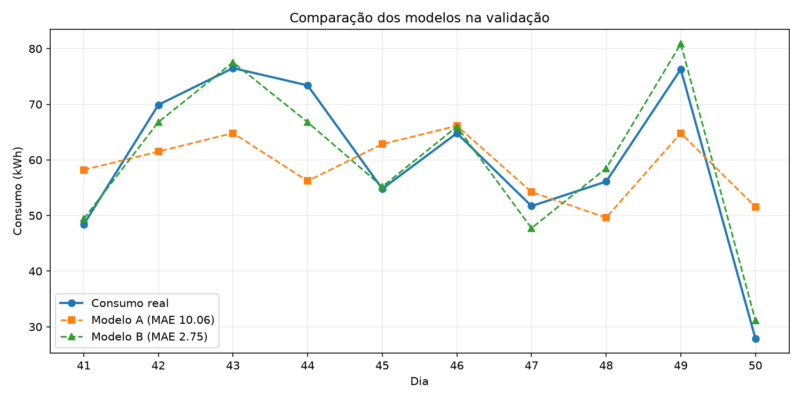
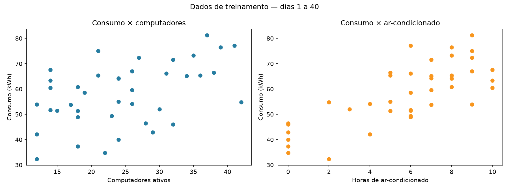

# Previsão do consumo de um laboratório com regressão linear

Este projeto compara dois modelos de regressão linear para prever o consumo diário de energia elétrica de um laboratório.

## Objetivo

Verificar se acrescentar as horas de uso do ar-condicionado à quantidade de computadores ativos melhora a previsão de `consumo_kwh`.

| Modelo | Variáveis de entrada | Variável prevista |
|:--|:--|:--|
| A | `computadores_ativos` | `consumo_kwh` |
| B | `computadores_ativos` e `horas_ar_condicionado` | `consumo_kwh` |

## Divisão dos dados

A base possui 60 dias e foi dividida cronologicamente, como no exercício de vendas:

| Etapa | Dias | Registros | Uso |
|:--|:--|--:|:--|
| Treinamento | 1–40 | 40 | Ajustar os modelos |
| Validação | 41–50 | 10 | Comparar e escolher o modelo |
| Teste | 51–60 | 10 | Avaliar o modelo escolhido |

O teste não foi usado para escolher o modelo.

## Resultados

| Indicador na validação | Modelo A | Modelo B |
|:--|--:|--:|
| MAE | 10,06 kWh | **2,75 kWh** |
| Dias com menor erro | 1 | **9** |

O modelo B foi escolhido por ter o menor erro absoluto médio. Seu MAE foi aproximadamente 72,7% menor que o do modelo A na validação.



### Validação detalhada

| Dia | Real | Previsão A | Erro A | Previsão B | Erro B | Melhor |
|---:|---:|---:|---:|---:|---:|:--|
| 41 | 48,40 | 58,20 | 9,80 | 49,40 | 1,00 | B |
| 42 | 69,90 | 61,51 | 8,39 | 66,79 | 3,11 | B |
| 43 | 76,50 | 64,81 | 11,69 | 77,56 | 1,06 | B |
| 44 | 73,40 | 56,22 | 17,18 | 66,78 | 6,62 | B |
| 45 | 54,80 | 62,83 | 8,03 | 55,20 | 0,40 | B |
| 46 | 64,80 | 66,13 | 1,33 | 65,97 | 1,17 | B |
| 47 | 51,70 | 54,23 | 2,53 | 47,73 | 3,97 | A |
| 48 | 56,10 | 49,61 | 6,49 | 58,49 | 2,39 | B |
| 49 | 76,30 | 64,81 | 11,49 | 80,87 | 4,57 | B |
| 50 | 27,90 | 51,59 | 23,69 | 31,17 | 3,27 | B |

### Teste final

Nos dias 51 a 60, o modelo B obteve **MAE de 2,70 kWh**.

Para um novo cenário com **30 computadores ativos** e **6 horas de ar-condicionado**, a previsão é de **63,48 kWh**.

## Gráficos dos dados



## Estrutura

```text
consumolaboratorio/
├── consumo_laboratorio.csv
├── exercicio.py
├── README.md
├── requirements.txt
└── resultados/
    ├── 01_dados_treino.png
    ├── 02_comparacao_validacao.png
    ├── comparacao_validacao.csv
    └── resultado_teste.csv
```

## Como executar

```bash
python -m pip install -r requirements.txt
python exercicio.py --sem-janelas
```

É possível alterar o cenário da nova previsão:

```bash
python exercicio.py --sem-janelas --computadores 35 --horas-ar 8
```

## Conclusão

Nesta base, incluir as horas de funcionamento do ar-condicionado melhorou bastante a previsão. Isso mostra associação nos dados analisados, mas não prova causalidade e não garante o mesmo desempenho em outros laboratórios ou períodos.
